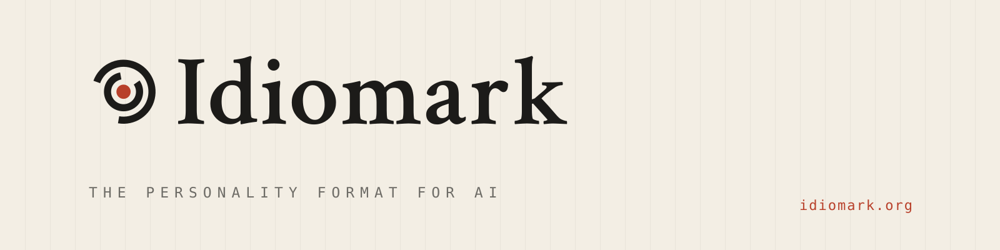

  

# Idiomark

> **The personality format for AI.**

A portable `.idiomark` file captures how a person speaks and thinks — voice, tone,
writing patterns, values, cognitive style — so AI systems can sound like that person
**and understand them**, on any model, on any platform.

Open source. MIT. No lock-in.

## Repositories

- **[idiomark](https://github.com/idiomark/idiomark)** — the format spec, SDK, CLI, and reference implementation

## Links

- Website: [idiomark.org](https://idiomark.org)
- Files: `.idiomark` · Packages: `@idiomark/*` on npm
